# PsiBoost

[](https://buymeacoffee.com/danedge)

> [!CAUTION]
> Only tested on a Psion Series 5mx running ROM 1.05(260), with the [PsiConnect](https://github.com/danieledge/psiconnect) Wi-Fi modem. Back up C: before you try it on your own Psion. If it works on anything other than a 5mx, or with another modem, open an issue and I will update this page.

Runs the **Psion Series 5mx**'s serial port at **230,400 bps** instead of 115,200 bps, twice as fast, for every program: PsiTerm, PsiMail, PsiWeb, PsiCast and the Psion's own Psion Internet (PPP). The Psion's serial driver stops at 115,200 bps; PsiBoost puts a small hook into it, so a program that asks for 115,200 bps gets 230,400 bps from the first byte, with nothing running in the background.

<p align="center">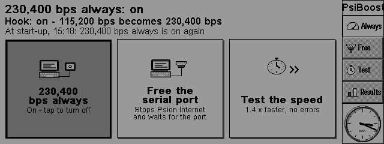</p>

- **230,400 bps always**: one choice. Turn it on and PsiBoost tells the modem 230,400 bps, puts the hook in, checks the modem answers at the new speed, and saves the speed on the modem. Turn it off and both go back to 115,200 bps. Other speeds are left alone.
- **At start-up** a small file on the CF card puts the hook back, after checking everything first.
- **Test the speed** runs the line at one speed, as it is now, or (with a modem) at 115,200 bps and then at 230,400 bps, back to back, and shows the two side by side.
- On a real 5mx, Psion Internet came out **2.1 times faster**, with no errors: downloads went from about 10 KB/s to 21.9 KB/s, about 95% of what the line can carry. This needs a modem that sends to the Psion as fast as the line allows during a Psion Internet call; the PsiConnect firmware does this from version 2.6. A modem that holds its sending back (PsiConnect before 2.6) keeps the gain smaller, about 1.4 times (4.6 to 6.9 KB/s).

**Status: early beta.** Tested on one Psion Series 5mx (ROM 1.05(260), English), with the PsiConnect Wi-Fi modem on its serial port, and in a 5mx emulator end to end. Expect rough edges.

PsiBoost is part of the [PsiTerm suite](https://github.com/danieledge/psiterm) (PsiTerm, PsiMail, PsiWeb, PsiCast) and uses its shared code, [psion-core](https://github.com/danieledge/psion-core).

## What you need

- A **Psion Series 5mx with ROM 1.05(260)**. On anything else PsiBoost does nothing (see *Other Psions*).
- A **CF card** (D:), for the file that puts the hook back at start-up.
- A **modem on the serial port that can run at 230,400 bps**, change speed by an AT command (`AT$SB=230400`, `ATB230400` or `AT+IPR=230400`) and save it with `AT&W`. The PsiConnect Wi-Fi modem firmware does all three, and is the only modem PsiBoost has been tested with.
- **Or a computer:** a serial cable to a computer, or any device whose speed you set yourself. See *With a cable to a computer (no modem)*.

## Installing

Download `PsiBoost.sis` from the [latest release](https://github.com/danieledge/psiboost/releases/latest) and install it, to D: if you can. The start-up file always goes on the CF card, whichever disk you choose. PsiBoost is on the Extras bar.

### The first time it opens

PsiBoost welcomes you and says what it has been tested on:

<p align="center">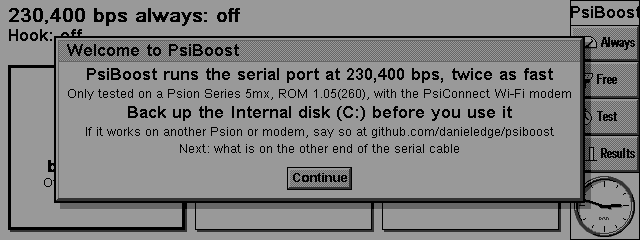</p>

Then it asks what is on the other end of the Psion's serial cable:

<p align="center"></p>

- **A Wi-Fi or dial-up modem**: anything that answers AT commands, such as the PsiConnect Wi-Fi modem, a dial-up modem or a phone. PsiBoost tells it the speed.
- **A computer or other device**: anything that does not answer AT, such as a computer on a serial cable or a USB serial adapter, running `pppd` or similar. PsiBoost sends it nothing: you set its port to 230,400 bps when 230,400 bps always is on.

The line under the choice says what to do next. Both pages need **Continue**: Esc does not get round them, and if PsiBoost is closed before then they come again next time. **Speed > The other end** changes the choice later. Upgrading from 0.23 or earlier, PsiBoost asks once too, unless it already knows (a computer chosen, or 230,400 bps always on with a modem).

## Using it

**230,400 bps always.** Tap it (or press Enter on it), and again to turn it off. The serial port must be free: close the program using it, or use **Free the serial port**, which stops Psion Internet if it is connected and waits up to 20 s for the port. While it works, the busy message says so:

<p align="center">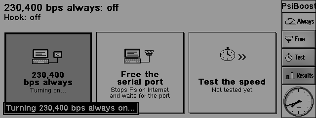</p>

If any step fails, the hook comes out, the modem goes back to 115,200 bps, and PsiBoost says why. If the modem does not answer when you turn it off, 230,400 bps always is off on the Psion anyway: set the modem back to 115,200 bps yourself. With a computer on the other end, only the hook goes in or out.

**The page** says whether 230,400 bps always is on, what the hook is doing now (and whether the modem is at the same speed: PsiBoost asks it when it opens, and **Speed > Check the modem's speed** asks again), and the last thing that happened.

<p align="center">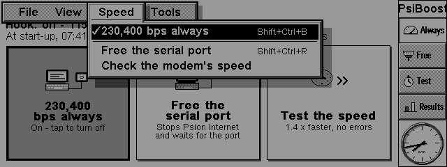</p>

**The Remote link** to a PC (PsiWin) at 115,200 bps gets 230,400 bps too. Set it to 57,600 bps, or turn 230,400 bps always off, before you use it.

### With a cable to a computer (no modem)

If the Psion is cabled straight to a computer (a null-modem cable, for example to a Linux PC running `pppd`), or to a device whose speed you set yourself, choose *A computer or other device* when PsiBoost first opens, or in **Speed > The other end**. If you chose a modem but none answers `AT` when you turn 230,400 bps always on, PsiBoost asks:

<p align="center">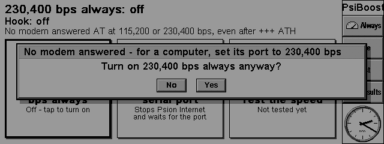</p>

Yes puts the hook in and nothing else, and PsiBoost remembers there is no modem, as if you had chosen a computer. Either way, turning it on and off, start-up and the page send no AT commands, and the page says what speed the other end must be at. (If the port is free, PsiBoost opens it once to check that the hook took, which sends one CR.) The port need not be free: a program that has it open keeps its speed until it opens it again. No or Esc leaves it off; Enter does not mean Yes. **Speed > The other end** switches between *A modem* and *A computer or other device* (with 230,400 bps always off).

<p align="center">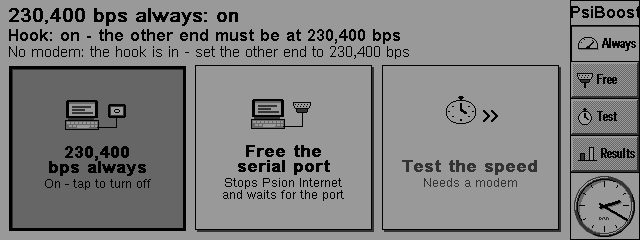</p>

Set the computer's end to 230,400 bps yourself. On Linux, for example:

```
pppd /dev/ttyUSB0 230400 ...        # pppd: the speed goes after the device
stty -F /dev/ttyS0 230400           # any other program: set the port first
```

Most USB serial adapters (FTDI, PL2303, CP210x) do 230,400 bps. A PC's own serial port often stops at 115,200 bps (a 16550 with the usual clock can go no faster), so try it before you rely on it. Turn 230,400 bps always off and the Psion is back at 115,200 bps: set the computer back too.

On the Psion, programs still ask for 115,200 bps, and the hook turns that into 230,400 bps. For Psion Internet, keep the setup you already use with the cable at 115,200 bps: PsiBoost changes only the speed. The Psion's own modem settings still send their initialisation string (and dial) before PPP starts, so the computer's end must cope with them as it does now.

**Test the speed** works with a computer one speed at a time, on Psion Internet: at 115,200 bps with 230,400 bps always off and the computer at 115,200 bps, then at 230,400 bps with both at 230,400 bps. *Both* needs a modem that changes speed with AT commands.

<p align="center">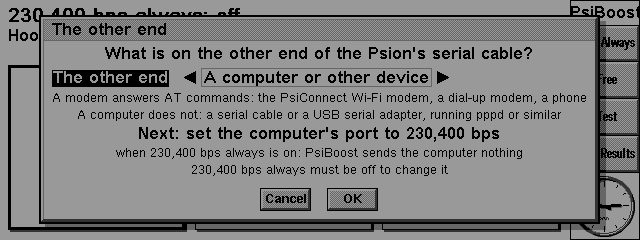 The other end: A Wi-Fi or dial-up modem or A computer or other device, what happens next, Cancel and OK" width="560"></p>

### Testing the speed

**Tools > Test the speed** runs a download and an echo on the modem route or Psion Internet, against one server, every byte checked, stalls and drops counted. **Speed** says at what:

- **115,200 bps** or **230,400 bps**: that speed only, with the line as it is now. PsiBoost changes nothing (no speed commands, the hook left as it is), so 230,400 bps always must be off for 115,200 bps and on for 230,400 bps, and the other end must be at that speed too. It works with a modem or a computer (with a computer, on Psion Internet: the modem route dials with `ATDT`). Only that speed's column of the results changes; the other keeps its last result, and when both have passed, the verdict compares them. It is offered at the speed 230,400 bps always is at now.
- **Both (the modem changes speed)**: 115,200 bps and then 230,400 bps, back to back. It needs a modem that changes speed with AT commands: the modem is told each speed in turn, and the second half asks the port for 115,200 bps and gets 230,400 bps through the hook, as every program does. Afterwards the modem and the hook are put back as 230,400 bps always says. With a computer on the other end it is not available.

<p align="center">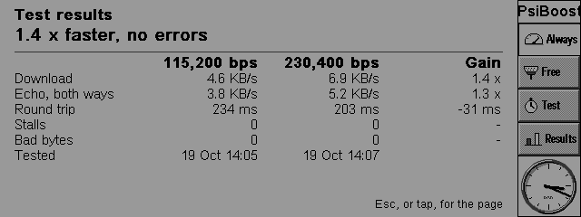</p>

*(A real 5mx's results, shown again in the emulator.)* The last row says when each speed was tested.

- **Public (internet)**: a 1 MB file over plain HTTP from a public speed-test server, and a public TCP echo (tcpbin.com).
<p align="center">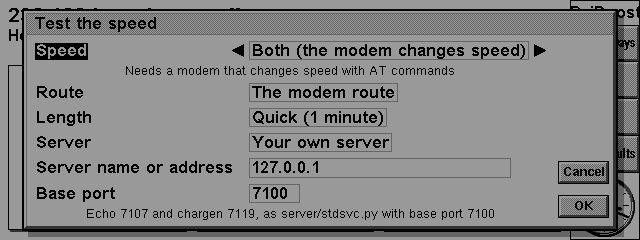</p>

- **Your own server**: an echo and a chargen service on a computer the Psion can reach. Run [`server/stdsvc.py`](server/stdsvc.py) there (`python3 stdsvc.py`; it needs only Python 3, and listens on all the computer's addresses). In the dialog choose *Your own server*, type the computer's name or address in **Server name or address**, and its base port in **Base port**. The echo is on the base port + 7 and the chargen on + 19: stdsvc.py's standard base port 7100 means 7107 and 7119 (and discard on 7109). `python3 stdsvc.py --base N` moves them to N+7, N+9 and N+19, and the Psion's Base port must then be N; 0 means a server's standard echo (7) and chargen (19). The line under Base port says which ports it will use, and the page shows the server under *Test the speed*. Let those ports through the computer's firewall.

<p align="center">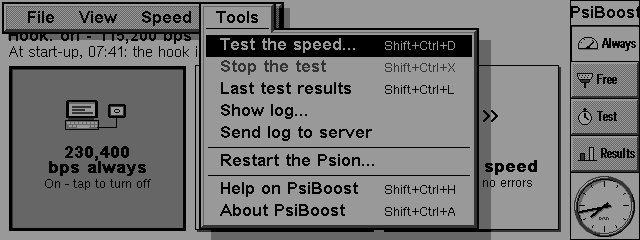</p>

### The log

Each step goes to `PsiBoost.log` in PsiBoost's folder, with what the modem said; the start-up file adds a line each time the Psion starts. Every speed test writes what was asked for (speed, route, server and ports), each step (the connections, with any error codes), each speed's byte counts and the result, and why it failed; so does every Send log, and PsiBoost itself writes when its helper could not be started. When it is full it becomes `PsiBoost.old`. **Tools > Show log** shows the end of it. **Tools > Send log to server** sends it to your own [PsiProxy](https://github.com/danieledge/psiproxy), the proxy set in Connection settings (in PsiTerm, PsiMail or PsiWeb), as those programs send theirs. With no proxy set it is not available. Nothing is sent anywhere unless you ask.

<p align="center">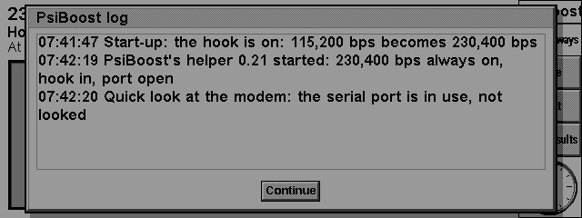 Show log: the end of PsiBoost.log" width="560"></p>

## Risks, and getting out of trouble

The hook runs inside the Psion's operating system. A mistake there resets the Psion, and the Internal disk (C:) is RAM: **back it up before you start**. PsiBoost cannot harm the Psion itself.

- **A soft reset takes the hook out.** Tools > Restart the Psion does one; so does the reset button. The files on C: stay.
- **To start without the hook**, hold down **Ctrl** while the Psion starts (from when the screen comes on until the System screen appears), or create the file `D:\System\Data\PsiBoost.off`.
- **If the Psion will not start properly**, take the CF card out and restart it: without the card nothing of PsiBoost's runs at start-up.
- **To remove PsiBoost**, turn 230,400 bps always off first (so the modem goes back to 115,200 bps), then remove it in the Control panel's Add/remove.

## Other Psions

The program, its helper and the start-up file all check the machine first: a 640x240 screen and ROM 1.05(260). On anything else they load no driver and write nothing, and 230,400 bps always shows as not available. The hook driver also checks the serial driver's objects in ROM before it writes, so even a ROM that passed that test but differed inside would be refused. The addresses PsiBoost needs are that ROM's; another ROM would need them found again. If it works for you on another Psion, open an issue.

## How it works

The serial driver programs the UART's baud divider in one function, reached through a vtable in ROM. PsiBoost's hook driver keeps a copy of that vtable whose configure entry calls the real one and then, if it set 115,200 bps, sets 230,400 bps. Installing the hook is a single word written to kernel memory: the vtable pointer of the serial driver's factory object, and only after checking that it and both ROM entries it wraps are exactly as expected. Nothing else in the kernel is changed. See [`docs/how-it-works.md`](docs/how-it-works.md) for the whole story, with the addresses.

## Building

PsiBoost carries [psion-core](https://github.com/danieledge/psion-core) (the build environment, the shared Connection settings, the icon writer and the emulator tools) as the git submodule `core/`. The EPOC R5 SDK goes beside the checkout, as psion-core's [`docs/BUILDING.md`](https://github.com/danieledge/psion-core/blob/dev/docs/BUILDING.md) says.

```
git clone --recurse-submodules https://github.com/danieledge/psiboost.git
cd psiboost
core/tools/docker/psibuild setup             # once: the build image and the SDK
core/tools/docker/psibuild "bash build.sh"   # build/pkg/PsiBoost.sis
```

| File | What it is |
|---|---|
| `psiboost.cpp`, `.rss`, `.hrh` | PsiBoost.app: the page, the menus, the dialogs, the hook read and put back |
| `pboostd.cpp` | `pboostd.exe`, the helper: all the serial work, while PsiBoost is open |
| `sptest.c`, `sptest.h` | the link test's arithmetic (chargen, echo, HTTP, MD5, the verdict), plain C |
| `spshared.h` | the memory the program and the helper share |
| `hook/pbhook.cpp`, `pbhook.h` | `PBHOOK20.LDD`, the hook |
| `uart/pbuart.cpp`, `pbuart.h` | `PBUART21.LDD`, the helper's reads of the UART's registers |
| `rec/pbrec.cpp` | `PsiBoost.rdl`, the start-up file (a file recogniser that recognises nothing) |
| `kern.h`, `ekern_rom.def` | the kernel classes and the 5mx ROM's EKERN ordinals, as the SDK has neither |
| `mktbar.py`, `mkicon.py` | the pictures and the icon |
| `psiboost.pkg`, `build.sh` | the package and the build |
| `server/stdsvc.py` | echo, discard and chargen, for the test's *Your own server* |

## Testing

`make -C test test` runs the link test's logic on a PC against `server/stdsvc.py`. `python3 test/modem_e2e.py HOSTMODEM` runs the modem route's dialogue against PsiConnect's modem code on a PC (its `hosttest/hostmodem`).

In the emulator (psion-core's `core/tools/emu/`, with [psionEmulators](https://github.com/joehaines/psionEmulators) beside this checkout and your own copy of the 5mx ROM):

```
node --experimental-strip-types core/tools/emu/mkcard.ts psiboostboot build/emu/boot.img
test/emu/boot.sh bootpage build/emu/boot.img      # start-up: the recogniser puts the hook in
python3 core/tools/emu/net.py boostsetup          # 230,400 bps always on and off against hostmodem
python3 server/stdsvc.py --host 127.0.0.1 &
python3 core/tools/emu/net.py boost               # the link test, both halves
python3 core/tools/emu/net.py boostone            # the link test at 115,200 bps only: no speed commands
```

`net.py` needs a [psiconnect](https://github.com/danieledge/psiconnect) checkout beside this one (or `PSICONNECT=DIR`) for its `hosttest/hostmodem`. The emulator does not model the UART's divider or the serial line's speed, so the speeds there are nominal: only a real 5mx shows 230,400 bps.

## Support

If it's useful to you and you'd like to say thanks, you can [buy me a coffee](https://buymeacoffee.com/danedge).

## Licence

MIT: see [LICENSE](LICENSE).
